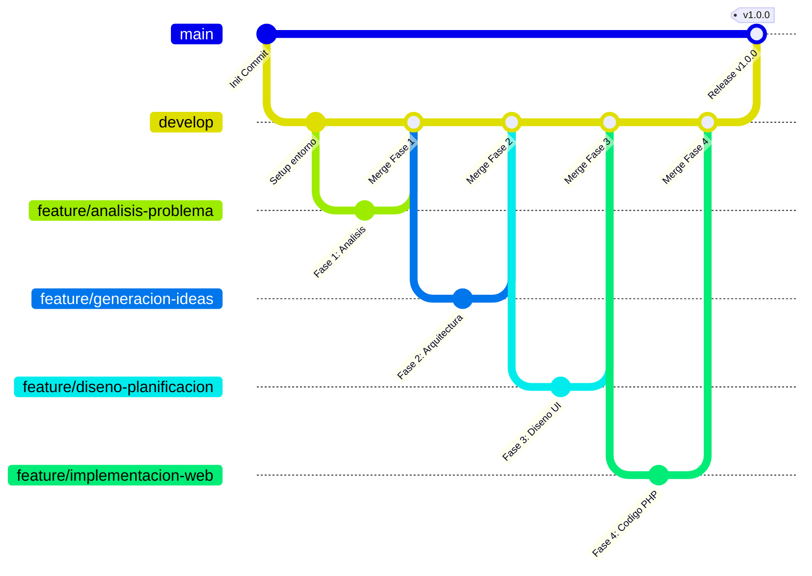

# Caso Práctico: Herramientas de Versionamiento
### Desarrollo Web Integral (DWI) - Unidad 2
**Universidad Tecnológica de Coahuila (UTC)**  
**Ingeniería en Desarrollo de Software**

---

[](https://github.com/AlejandroDeveloperJunior/GuzmanJuarezJulioFranciscoAlejandro_DWI_U2)
[](https://www.php.net/)
[](https://git-scm.com/)
[](https://github.com/AlejandroDeveloperJunior/GuzmanJuarezJulioFranciscoAlejandro_DWI_U2/releases/tag/v1.0.0)
[](https://github.com/AlejandroDeveloperJunior/GuzmanJuarezJulioFranciscoAlejandro_DWI_U2)

---

## 📌 Datos Generales de la Entrega

| Campo | Detalle |
| :--- | :--- |
| **Institución** | Universidad Tecnológica de Coahuila (UTC) |
| **Asignatura** | Desarrollo Web Integral (DWI) |
| **Unidad Temática** | Unidad 2: Herramientas de Versionamiento |
| **Actividad** | Caso Práctico - Ciclo de Desarrollo Web y Versionamiento |
| **Alumno** | **Julio Francisco Alejandro Guzmán Juárez** |
| **Matrícula** | **23040086** |
| **Docente** | **M.A.Y.L. Gabriel Alejandro Reyes Morales** |
| **Lugar y Fecha** | Ramos Arizpe, Coahuila — Octubre 2026 |

---

## 📋 Estructura y Evaluación del Caso Práctico

El presente proyecto atiende y desglosa en su totalidad los **4 puntos de evaluación** del Caso Práctico:

```
PROYECTO WEB
  ├── 1. ANÁLISIS DEL PROBLEMA    (feature/analisis-problema)
  ├── 2. GENERACIÓN DE IDEAS       (feature/generacion-ideas)
  ├── 3. DISEÑO Y PLANIFICACIÓN   (feature/diseno-planificacion)
  ├── 4. IMPLEMENTACIÓN           (feature/implementacion-web)
  └── [ÉXITO / LIVE]              (main - Cloud Host)
```

---

### 1. Justificación de las Plataformas y Herramientas de Versionamiento (1 Punto)

Para el desarrollo del proyecto se seleccionó un conjunto de herramientas alineadas con los más altos estándares de la ingeniería de software:

* **Git (Sistema de Control de Versiones Distribuido - DVCS):**
  * **Arquitectura Distribuida:** A diferencia de sistemas centralizados como SVN, cada colaborador posee un clon completo y autónomo del historial criptográfico del proyecto.
  * **Integridad Criptográfica:** Cada objeto (blob, tree, commit) se identifica de forma inmutable mediante sumas hash SHA-1/SHA-256, imposibilitando la alteración no detectada del código.
  * **Ramificación Ultraligera:** La creación y alternancia de ramas es casi instantánea (creación de punteros a commits), permitiendo flujos de trabajo paralelos y aislados sin sobrecarga computacional.
  * **Autonomía Offline:** Capacidad de realizar commits, navegación por el historial y resolución de diferencias sin conexión de red.

* **GitHub (Plataforma Remota & DevOps):**
  * **Nodo Central y Gobernanza:** Plataforma en la nube de alta disponibilidad para el alojamiento remoto del repositorio.
  * **Flujo Colaborativo y Revisión por Pares:** Soporte para *Pull Requests*, facilitando la inspección de código y validación técnica antes de la integración a ramas protegidas.
  * **Automatización CI/CD:** Motor *GitHub Actions* para pipelines automatizados de despliegue y validación continua.

* **Laragon (Entorno de Desarrollo Local):**
  * **Aislamiento y Eficiencia:** Pila WAMP moderna, portable y de bajo consumo en Windows.
  * **Paridad de Entorno:** Permite ejecutar Apache 2.4 y PHP 8.3 de manera idéntica al entorno de producción, con soporte para virtual hosts locales automáticos (`.test`) y certificados SSL locales.

* **Cloud Host (Alojamiento en la Nube):**
  * **Disponibilidad 24/7:** Servicio activo sin dependencia de hardware personal encendido ni configuraciones complejas de enrutamiento IP local.
  * **Seguridad y Certificados:** Protocolo HTTPS activo de forma nativa mediante certificados TLS 1.3 gestionados.
  * **Despliegue Continuo (CD):** Integración nativa con GitHub mediante Webhooks, desplegando los cambios automáticamente tras cada fusión en la rama `main`.

---

### 2. Flujo de Trabajo del Control de Versiones (1 Punto)

Se adoptó una arquitectura de ramas estricta basada en el modelo **Gitflow**, adaptando sus ramas de características a las etapas del proyecto web:



#### Jerarquía de Ramas:
1. `main`: Rama de producción (código 100% verificado y estable, enlazado con el Cloud Host).
2. `develop`: Rama de integración donde convergen las fases de desarrollo.
3. `feature/analisis-problema`: Rama para documentación de alcances y requerimientos de la Fase 1.
4. `feature/generacion-ideas`: Rama para configuración de contenedores, IaC (`render.yaml`) y arquitectura.
5. `feature/diseno-planificacion`: Rama para la maquetación visual, paleta de colores y componentes interactivos.
6. `feature/implementacion-web`: Rama para la implementación completa del código PHP dinámico y estático.
7. `hotfix/*`: Ramas de mantenimiento urgente en caso de anomalías en producción.

#### Políticas de Commits y Versionado:
* **Conventional Commits:** Mensajes estructurados con prefijos semánticos (`feat:`, `fix:`, `docs:`, `style:`, `refactor:`, `chore:`).
* **Integración No Fast-Forward (`--no-ff`):** Todas las fusiones retienen el nodo de merge explícito para preservar el historial visual de bifurcaciones.
* **Versionado Semántico (SemVer):** Etiquetado con Git Tag anotado `v1.0.0` para marcar la entrega formal del caso práctico.

---

### 3. Parámetros de Configuración de las Plataformas y Herramientas (1 Punto)

#### Configuración Global del Alumno en Git CLI:
```bash
# 1. Identidad del autor para trazabilidad y auditoría
git config --global user.name "Julio Guzman"
git config --global user.email "23040086@alumno.utc.edu.mx"

# 2. Manejo de terminaciones de línea entre Windows (CRLF) y Linux (LF)
git config --global core.autocrlf true

# 3. Rama principal predeterminada
git config --global init.defaultBranch main

# 4. Almacenamiento seguro de credenciales con el Administrador de Windows
git config --global credential.helper manager

# 5. Estrategia de pull segura
git config --global pull.rebase false

# 6. Vinculación del origen remoto en GitHub
git remote add origin https://github.com/AlejandroDeveloperJunior/GuzmanJuarezJulioFranciscoAlejandro_DWI_U2.git
```

#### Parámetros en el Repositorio (`.gitignore`):
Se configuró un archivo `.gitignore` profesional para excluir:
* Archivos del sistema (`Thumbs.db`, `Desktop.ini`).
* Directorios de configuración de IDEs (`.vscode/`, `.idea/`).
* Archivos temporales de edición de Microsoft Office (`~$*.docx`, `~$*.xlsx`).
* Dependencias y variables de entorno (`/vendor/`, `.env`, `node_modules/`).
* Logs de servidor y cachés locales de Laragon.

---

### 4. Repositorio en Funcionamiento y Despliegue en Cloud Host (1 Punto)

* **Enlace del Repositorio Oficial:**  
  👉 **[https://github.com/AlejandroDeveloperJunior/GuzmanJuarezJulioFranciscoAlejandro_DWI_U2](https://github.com/AlejandroDeveloperJunior/GuzmanJuarezJulioFranciscoAlejandro_DWI_U2)**

* **Estructura del Flujo de Trabajo en GitHub:**  
  * Rama `main` (Producción)
  * Rama `develop` (Integración)
  * Ramas `feature/*` (Fases del ciclo web)
  * Tag de versión `v1.0.0`

* **Despliegue en Cloud Host:**  
  * El proyecto cuenta con soporte de despliegue en múltiples plataformas Cloud Host:
    * **GitHub Pages (Cloud Host nativo de GitHub):** Desplegado automáticamente mediante GitHub Actions (`.github/workflows/deploy.yml`).
    * **Render / Railway / Koyeb:** Despliegue en la nube mediante `Dockerfile` (PHP 8.3 Apache) y especificación `render.yaml`.
  * **Evidencias Gráficas:**  
    Las capturas de pantalla de alta resolución que demuestran el funcionamiento del sitio en el Cloud Host y en el entorno local se encuentran integradas en el documento de reporte entregable (`.docx` y `.pdf`).

---

## 🛠️ Ejecución Local

Para levantar el proyecto en un entorno local:

1. Clonar el repositorio:
   ```bash
   git clone https://github.com/AlejandroDeveloperJunior/GuzmanJuarezJulioFranciscoAlejandro_DWI_U2.git
   ```
2. Mover el proyecto al directorio de Laragon:
   ```bash
   # Directorio: C:\laragon\www\GuzmanJuarezJulioFranciscoAlejandro_DWI_U2
   ```
3. O iniciar con el servidor embebido de PHP:
   ```bash
   php -S localhost:8000
   ```
4. Abrir en el navegador: `http://localhost:8000`

---

## 👨‍💻 Autor
* **Julio Francisco Alejandro Guzmán Juárez**  
* Matrícula: 23040086  
* Correo institucional: `23040086@alumno.utc.edu.mx`  
* Universidad Tecnológica de Coahuila (UTC)
